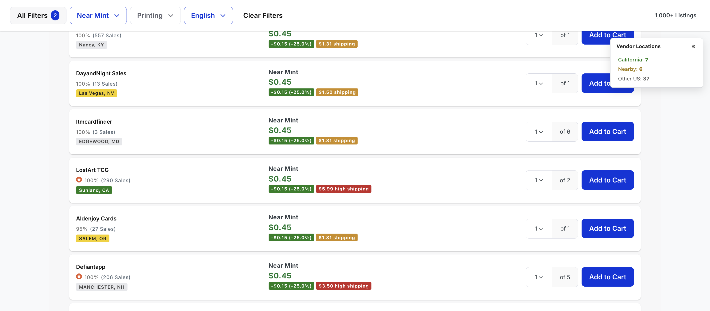
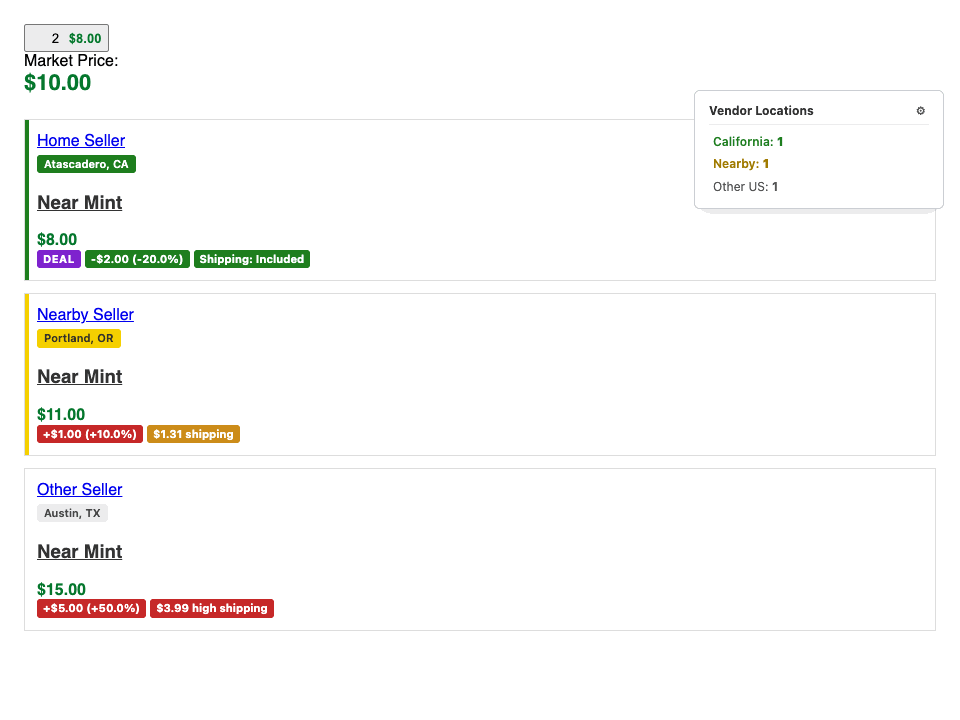
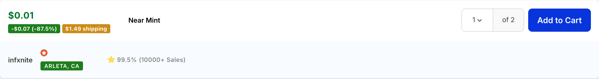
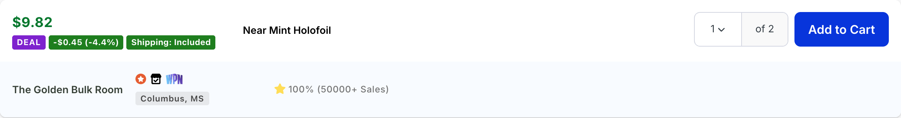
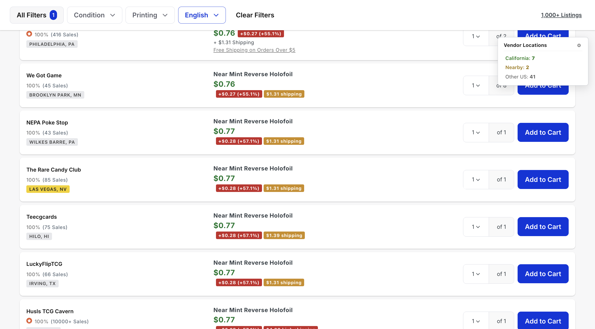
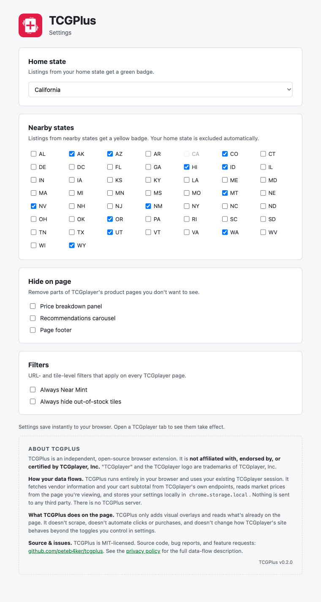

# TCGPlus

TCGPlus helps you buy cards on TCGplayer for less. On every listing it shows whether the price is good, what shipping will really cost, and where the seller is, so you can find the best listing without opening each one.

## Install

Install TCGPlus from the [Chrome Web Store](https://chromewebstore.google.com/detail/tcgplus/laaddebgfkkfemgjgjibdhpnflmchjaj). To run an unreleased build, see [Install from source](#install-from-source).

## Features

TCGPlus works on product pages, search results, seller storefronts, the cart and checkout.

### See whether a price is good

Each listing shows how far its price is from the market price, for example `+$5.00 (+16.7%)`. You can tell at a glance which listings are cheap and which are overpriced, without doing the math yourself.

The chip is green below market and grey at market. Above market it shifts from yellow to orange to red, reaching full red at 10% over.

**Below market**

**Near market**

**Above market**

On the search grid and on seller storefronts (`tcgplayer.com/sellers/…`), each tile gets the same chip. There the chip compares TCGplayer's cheapest listing price, which includes shipping, against market, so it can read slightly worse than the list view for the same card. The chip's tooltip says so.

#### Which market price is used

A Reverse Holofoil card and a Normal card can have very different prices, and so can Near Mint and Lightly Played copies. TCGPlus compares each listing against the market price for its own printing and condition, not the single headline price at the top of the page.

TCGplayer updates market prices for less common conditions more slowly than for Near Mint, so a Lightly Played price can briefly sit above the Near Mint price. TCGPlus caps each condition's market price at the price of the better condition above it (Near Mint, then Lightly Played, Moderately Played, Heavily Played, Damaged). That stops a stale price from making a listing look like a deal.

If TCGplayer's per-printing prices can't be loaded, TCGPlus falls back to the headline market price. It then only shows a price chip on listings whose condition matches that headline price. Other listings get the shipping chip only, rather than a misleading comparison.

### Know what shipping will cost

A cheap card with expensive shipping isn't cheap. TCGPlus replaces each listing's plain shipping line with a coloured chip: green when shipping is included, yellow under $2, and red at $2 or more ("high shipping").

### Spot real deals, shipping included

A card $0.50 under market isn't a deal if it costs $1.49 to ship. The purple **DEAL** badge appears only when what you'd actually pay, the price plus any shipping it adds to your order, is still below market.

It also accounts for shipping you've already paid. TCGplayer charges one shipping fee per seller, so once you have a card from a seller in your cart, more cards from them ship in the same package at no extra cost. The badge updates as your cart changes.

**How it's calculated.** The badge compares the listing price plus its shipping against the market price. The shipping counted is:

- **Seller already in your cart:** none.
- **"Free Shipping on Orders Over $5" promo:** none, when the listing's price is $5 or more. TCGplayer sets this $5 threshold; sellers can't change it.
- **Otherwise:** the listing's stated shipping.

TCGplayer bases the final fee on the largest item in the order. Adding sealed product to a cart of singles from the same seller can therefore cost a little more shipping than the badge assumes.

### See where each seller ships from

A seller near you usually means faster delivery. TCGPlus shows each seller's city and state under their rating, so you can choose a closer seller without opening their storefront. Listings from your home state and nearby states also get a coloured stripe on the left, so they stand out as you scroll.

The badge is green for your home state, yellow for the nearby states you choose in settings, plain grey for the rest of the US, and blue-grey for international sellers.

When you're shopping a single seller's inventory, the location appears once in the "You are shopping from" banner instead of on every listing.

### Filter listings by location

A floating panel counts the listings on the page by location: your home state, nearby states, and the rest of the US. Click a group to show only those listings, and click it again to show everything. You can also Tab to a group and press Enter or Space. The filter you pick stays on when you reload or move to another product.

If TCGPlus can't read part of a page, for example after TCGplayer changes its layout, the panel shows a warning. That way you know which numbers to discount.

### Check whether your whole cart is worth it

Before you pay, TCGPlus tells you whether your cart beats buying the same cards at market price, the way you would at a card show, after shipping and tax. A result like `-$3.14 (-8.2%)` means you're paying $3.14 less than market.

The breakdown appears in two places:

- **Cart page:** in the Cart Summary, labelled "before tax" because TCGplayer adds tax at checkout.
- **Checkout:** in the Order Summary, under Est. Tax, with tax included.

It lists the cart's market value, the items total, shipping and tax. Each item with a known market price also gets its own price chip. Market value uses each item's own printing, condition and quantity. Items with no market price are counted at the price you're paying, and a note says how many.

TCGPlus checks its total against the cart's own total before showing a result. If they don't match, for example because a row couldn't be read, it says so instead of showing a wrong number.

### Track your spending from any page

TCGPlus shows your cart subtotal next to the cart icon in TCGplayer's header, so you can see what you're spending without opening the cart. It appears once the cart has loaded and has something in it, and it updates when you add or remove items.

### Settings

To open settings, click the gear on the floating panel, click the TCGPlus icon in your browser toolbar, or choose **Extension options** in `chrome://extensions`.

- **Home state:** where you live, so nearby sellers stand out. Default: California.
- **Nearby states:** other states whose sellers you'd consider close. Default: the western US (OR, WA, NV, AZ, ID, UT, MT, WY, CO, NM, AK, HI). Your home state can't also be a nearby state.
- **Hide on page:** remove parts of TCGplayer's product pages you don't use: the price breakdown panel, the recommendations carousel and the page footer.
- **Always Near Mint:** skip setting the condition filter on every search. TCGPlus adds `Condition=Near+Mint` to any product or search page address that lacks it, including when you move between pages inside TCGplayer. Off by default.
- **Hide tiles with no matching listings:** clean up search results. TCGplayer marks these tiles "Out of Stock", but usually the card is available in another language or condition that your filters exclude. When any are on the page, a banner above the results shows how many and lets you show or hide them. Off by default.

Changes apply immediately to open TCGplayer tabs. Settings are stored on your computer in `chrome.storage.local`.

## Privacy

TCGPlus runs entirely in your browser. There is no TCGPlus server, no account and no analytics. It talks only to TCGplayer:

- `seller-stores-backend.tcgplayer.com/sm/seller/<key>`: each seller's location, for the location badge.
- `mpgateway.tcgplayer.com/v1/cart/<key>/summary`: your cart subtotal and how much you have from each seller.
- `mp-search-api.tcgplayer.com/v2/product/<id>/details` and `mpgateway.tcgplayer.com/v1/pricepoints/marketprice/skus/search`: each product's printings and conditions, and their market prices. These feed the price chips, the DEAL badge and the cart verdict.

These three hosts are the extension's only host permissions. Only the cart request sends your TCGplayer session cookies, because the cart belongs to your session; the others are sent without cookies. If per-printing prices can't be loaded, TCGPlus reads the market price shown on the page instead. Nothing is sent anywhere else. See the [privacy policy](docs/privacy.md) for details.

## Development

Plain MV3 extension, no build step. See [docs/development.md](docs/development.md) for the dev build, tests, and CI.

### Install from source

For local development or testing an unreleased build:

1. Clone this repo, or download the latest [release zip](../../releases).
2. In Chrome, open `chrome://extensions`.
3. Turn on **Developer mode** (top right).
4. Click **Load unpacked** and select this directory.
5. Visit any product page (`https://www.tcgplayer.com/product/*`), search page (`https://www.tcgplayer.com/search/*`), or seller storefront (`https://www.tcgplayer.com/sellers/*`).

## License

MIT, see [LICENSE](LICENSE).
